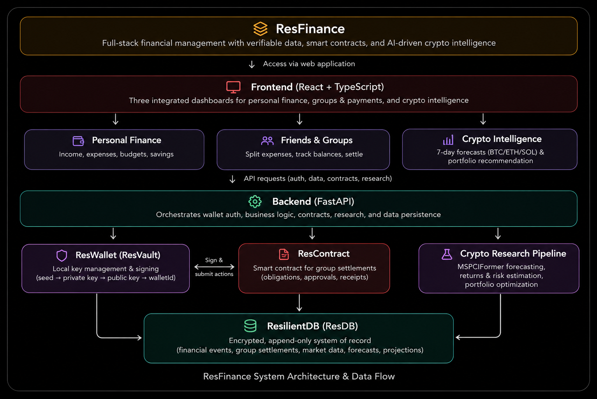

# ResFinance

ResFinance is an AI-powered financial management platform built on ResilientDB, integrating ResWallet (secured wallet authentication built on ResVault) and ResContract (smart contracts) for personal finance management, group expense splitting, auditable settlements, and ML-driven cryptocurrency forecasts with risk-aware portfolio allocation recommendations.

> For milestone progress and current readiness, see [`docs/ResFinance-Current-Status.md`](docs/ResFinance-Current-Status.md).
>
> The canonical eight-milestone convention is defined in [`docs/milestones/milestones.md`](docs/milestones/milestones.md).

---

## Core Features & Capabilities

- **Personal Finance:** Append-only income, expenses, budgets, recurring items, savings, and evidence-linked read-only insights.
- **Friends & Groups:** Shared bill splits, ResWallet-approved
  obligations, Non-redeemable internal-credit settlement, and Finance updates.
- **Crypto Intelligence:** BTC/ETH/SOL-only 7-day research forecasts and
  read-only allocation scenarios based on available savings.
- **Architecture-aware welcome:** The responsive wallet-authentication screen
  pairs the existing ResWallet flow with the complete system diagram and a
  reduced-motion-safe SVG data-flow overlay.

## Architecture



- The React client communicates only with the FastAPI `/api/v1` service.
- ResWallet holds keys and approves actions.
- ResContract is authoritative for settlement.
- Apache ResilientDB is the sole persistent application and research store.
- Events are encrypted where sensitive, append-only, schema-versioned,
  idempotent, and reducer-rebuildable.

## Scope and safety

- Local implementation is complete, and the project remains limited to local-development and non-commercial research scope. Cloud and production deployment is on hold as of now.
- USD is the only V1 fiat denomination; money is stored as integer cents.
- Crypto support is exactly `BTC | ETH | SOL`.
- Seeds and private keys never leave ResWallet; contract-affecting actions need
  explicitly approved, backend-verified signed intents.
- Internal credits are non-redeemable and non-monetary. ResFinance does not
  transfer fiat or cryptocurrency, trade, custody assets, or provide investment advice.
- Scenario analysis and AI are read-only.

## Repository layout

```text
client/        React and TypeScript application
reswallet/     ResWallet browser extension
server/        FastAPI API, domain services, adapters, and workers
blockchain/    ResContract contracts, gateway adapter, wallet work, and tests
ml/            Data, features, forecasting, evaluation, and portfolio optimization
requirements/  Pinned Python dependency sets for development and runtime areas
tests/         Contract, integration, and end-to-end tests
docs/          Product, architecture, milestone evidence, and development references
```

## Documentation

- [ResFinance Blog](https://medium.com/@haseebshaik00/resfinance-57064e9a54ef)
- [Product Specification](docs/project-spec.md)
- [Architecture and Implementation Plan](docs/architecture-implementation-plan.md)
- [Local Demo Runbook](docs/local-demo-runbook.md)
- [Local Operator Guide](docs/local-operator-guide.md)
- [REST API Contract](docs/rest-api-contract.md)
- [Security Contract](docs/security.md)
- [ResFinance MSPCIFormer Research](docs/research/ResFinance-MSPCIFormer-Research.pdf)
- [ResFinance Research Flow](docs/research/ResFinance-Research-Flow.pdf)
- [Provider coverage and terms review](docs/provider-terms-review.md)
- [ResilientDB ecosystem development references](docs/development-references.md)
- [Canonical Milestone Convention](docs/milestones/milestones.md)
- [Milestone Evidence](docs/milestones/)
- [Current milestone status](docs/ResFinance-Current-Status.md)
- [Repository instructions for coding agents](AGENTS.md)

## Contributors

- [Shaik Haseeb Ur Rahman](https://github.com/haseebshaik00)
- [Anish Kataria](https://github.com/AnishK10)

## License

See [LICENSE](LICENSE) for the repository license.
